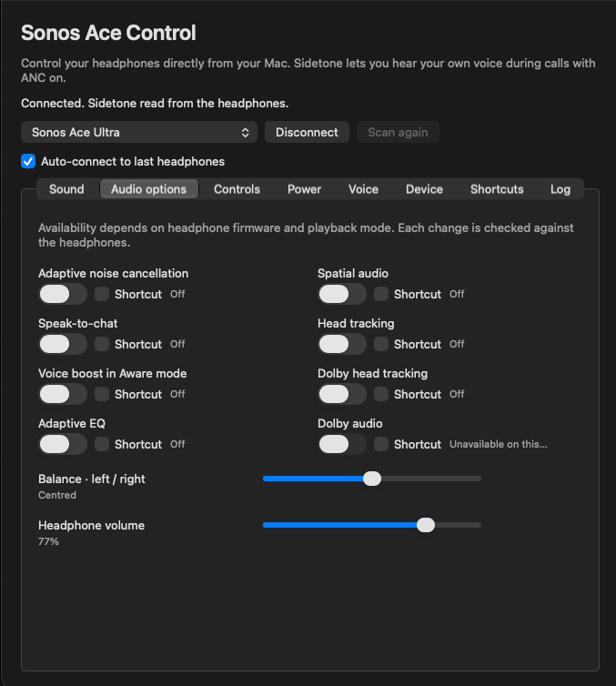
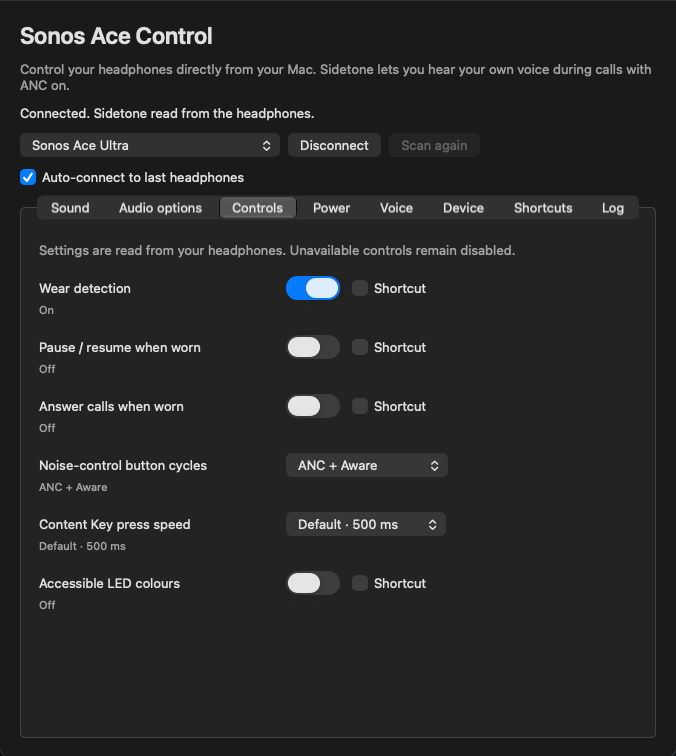
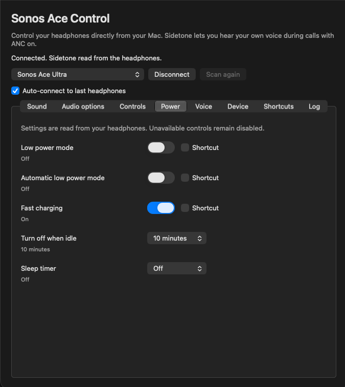
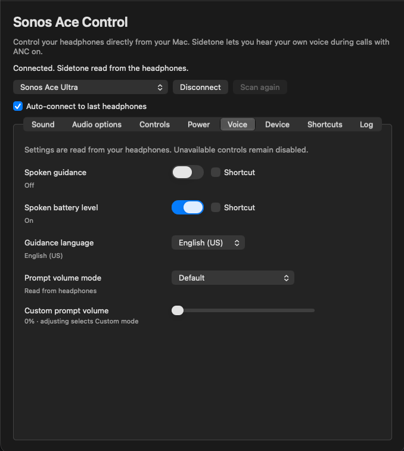
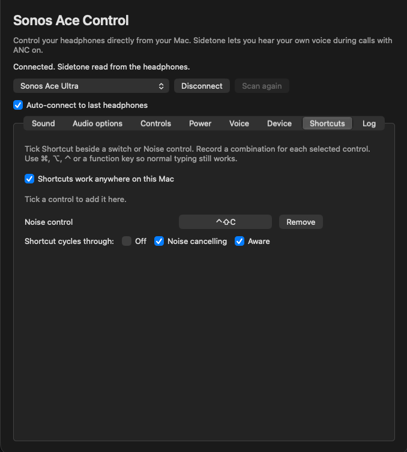

# Sonos Ace Control

An independent macOS controller for Sonos headphones over Bluetooth LE, tested
with Sonos Ace Ultra. Requires macOS 13 or later.

## Screenshots

<table>
  <tr>
    <td align="center"><strong>Sound</strong><br></td>
    <td align="center"><strong>Audio options</strong><br></td>
    <td align="center"><strong>Controls</strong><br></td>
  </tr>
  <tr>
    <td align="center"><strong>Power</strong><br></td>
    <td align="center"><strong>Voice</strong><br></td>
    <td align="center"><strong>Shortcuts</strong><br></td>
  </tr>
</table>

## Features

- Menu bar controls and headphone battery level.
- Noise control, sidetone, equalizer, and other audio, power, voice, and device settings.
- Optional auto-connect to the last connected headphones.
- Global keyboard shortcuts for selected controls, with a choice of which noise
  modes the shortcut cycles through.
- Settings changes verified by reading them back from the headphones.

## Install

Download the ZIP from [Releases](https://github.com/Bigsy/sonos-ace-control/releases),
unzip it, and move **Ace Control.app** to Applications. The release supports Apple
silicon and Intel Macs. Allow Bluetooth access when macOS asks.

Releases are Developer ID-signed but not notarized. If macOS blocks the first
launch, try opening the app, then use **System Settings → Privacy & Security →
Open Anyway** as described by [Apple](https://support.apple.com/en-gb/102445).

## Use

Select your headphones and connect. You can then enable **Auto-connect to last
headphones** in the window or menu bar. If connection fails, close the Sonos
phone app and try again.

The menu bar icon provides quick access to settings. Tick **Shortcut** beside a
control to add it to the Shortcuts tab, where you can record a key combination
and choose which noise modes to cycle through. Shortcuts work while the app is
running, even when its window is closed.

## Build from source

Install Xcode or its Command Line Tools (`xcode-select --install`), then run:

```sh
git clone https://github.com/Bigsy/sonos-ace-control.git
cd sonos-ace-control
sh build.sh
open '.build/Ace Control.app'
```

No third-party dependencies are required. For a universal build, use
`ACE_ARCHS=universal sh build.sh`. The script uses an available Apple Development
certificate; without one, ad-hoc signing may cause repeated Bluetooth permission
prompts. Maintainers can use `sh tools/package_release.sh` to create a signed
universal ZIP, and set `ACE_NOTARY_PROFILE` to notarize it.

## Licence

MIT. See [LICENSE](LICENSE).
